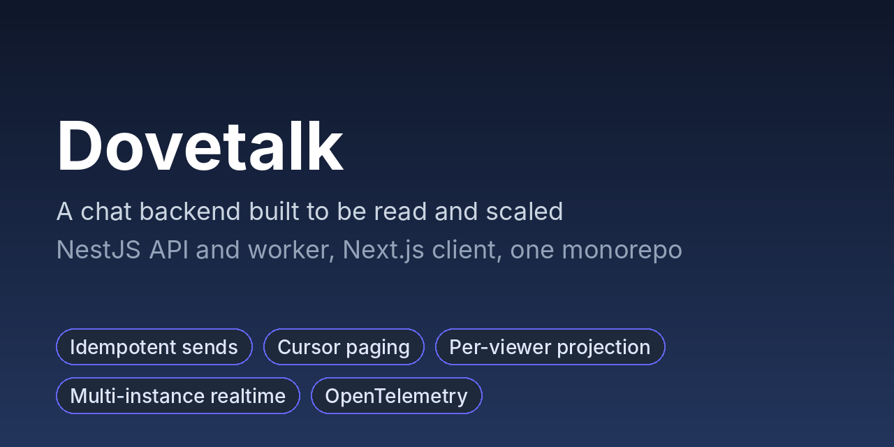
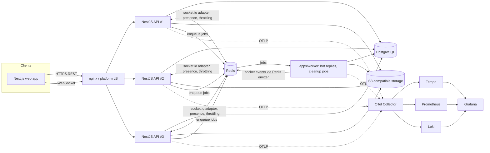

<p align="center">
  
</p>

# Dovetalk

[](https://github.com/OWNER/dovetalk/actions/workflows/ci.yml)
[](https://github.com/OWNER/dovetalk/actions/workflows/codeql.yml)
[](https://codecov.io/gh/OWNER/dovetalk)
[](LICENSE)

A chat app with a NestJS API, a background worker and a Next.js web client. It was built to show how the
hard parts of a messaging backend are done, and to be read: real-time messaging across several API instances,
idempotent sends, cursor paging, one shared dataset shown differently to each person, and OpenTelemetry from the
API through Redis and the worker to the database.

**Live demo:** not deployed yet. Run it yourself in two commands, below. The planned hosting is in
[docs/architecture.md](docs/architecture.md) and the [roadmap](docs/roadmap.md).

## What is in it

- **Accounts and sessions.** Register, sign in, or try it as a guest. Short-lived access tokens, rotating refresh
  tokens in an `httpOnly` cookie, with reuse detection ([ADR 0016](docs/adr/0016-refresh-token-rotation.md)).
- **Contacts, chats and groups,** with per-person pinning, archiving, muting, blocking and "clear chat".
- **Messages:** text, photos, files and voice notes, replies, reactions, edits, forwarding, and delete for me or
  for everyone. Uploads go to S3-compatible storage and are served by signed URLs.
- **Statuses** that expire after a day, and **typing and presence** in real time.
- **Bots** that answer after a believable pause, run by a separate worker. New accounts start with 14 contacts,
  11 chats and 153 messages so there is something to look at.
- **A web client** that runs on the real API, or on an in-browser mock server for development without a backend.

## What to look at first

- **Idempotent sends.** `POST /chats/:id/messages` takes a client-made `clientId`. Sending it again returns the
  stored message (`200`, not `201`) and adds nothing, not even an unread count, even when eight requests arrive at
  once. [ADR 0014](docs/adr/0014-idempotency-keys-for-sends.md)
- **Cursor paging.** `GET /chats/:id/messages?before=<messageId>&limit=25` walks back through history by the chat's
  own sequence number, so a page costs the same at message 20 as at message 20,000, and paging stays whole when
  you have hidden a message. [ADR 0015](docs/adr/0015-cursor-paging-over-offset.md)
- **Per-viewer projection.** The same message has different `senderId` and reaction ids for each person, because
  each has their own contacts. One `Projector` makes every DTO.
  [ADR 0003](docs/adr/0003-per-viewer-projection.md)
- **Realtime across instances.** Each person's events go to their own socket.io room through Redis, so a message
  sent through one API instance reaches a socket on another, and so does a job in the worker. Presence lives in
  Redis with a heartbeat, so a crashed instance's people still go offline. WebSocket only, so no sticky sessions.
  [ADR 0009](docs/adr/0009-realtime-delivery-and-presence.md), [ADR 0013](docs/adr/0013-scale-out-without-sticky-sessions.md)
- **Bots and background jobs.** Writing to a bot sets two delayed jobs going in Redis (BullMQ): the bot shows as
  typing after about 0.7 s and answers after about 2.4 s. A worker can be killed, restarted or run twice without a
  reply being lost or sent twice, because the job id and the reply's `clientId` come from the message id.
  [ADR 0004](docs/adr/0004-bullmq-over-rabbitmq.md), [ADR 0010](docs/adr/0010-job-design-and-cleanup.md)
- **Blocking.** The person who blocked you never sees your messages, and you are not told.
  [ADR 0017](docs/adr/0017-blocking-semantics.md)
- **One conformance suite** runs against both the mock and the real API, so they cannot drift apart.
  [ADR 0007](docs/adr/0007-one-conformance-suite-for-both-backends.md)

## Tech stack

| Area               | Choice                                                                                  |
| ------------------ | --------------------------------------------------------------------------------------- |
| Language           | TypeScript (strict), Node 26, pnpm workspaces                                           |
| API                | NestJS, REST with an OpenAPI document, socket.io (WebSocket only)                       |
| Background work    | A NestJS standalone worker with BullMQ queues and repeatable jobs                       |
| Data               | PostgreSQL with Drizzle ORM and SQL migrations in git                                   |
| Cache and messaging | Redis: socket.io adapter, presence, rate limits, job queues                            |
| Files              | S3-compatible storage (SeaweedFS locally, any S3 service in production), signed URLs   |
| Web client         | Next.js, React, TanStack Query, Zustand, Tailwind                                       |
| Observability      | OpenTelemetry, Collector, Tempo, Prometheus, Loki, Grafana (dashboards generated as code) |
| Testing            | Vitest, Testcontainers, Playwright, k6, a conformance suite shared by the mock and the API |
| Tooling            | Biome through Ultracite, dependency-cruiser, Husky, commitlint, Renovate, release-please |
| Delivery           | Docker Compose profiles, nginx, GitHub Actions                                          |

## Architecture



The API and the worker deploy and scale independently and share code through packages. See
[ADR 0001](docs/adr/0001-two-deployables-shared-libraries.md). [docs/architecture.md](docs/architecture.md) has more
diagrams: the package dependencies, the database, one message from browser to browser, and where it runs. The
decisions are in the [ADRs](docs/adr/README.md).

## Quick start

Needs Docker. This builds and runs the whole app from source: the web client, the API, the worker and their
services.

```bash
cp .env.example .env
docker compose --profile app up -d --build
```

Then open http://localhost:3000. Create an account, choose Try the demo, or sign in as `demo@dovetalk.app` /
`dovetalk123`. The migrations run first and the demo account is seeded (`SEED_DEMO_ACCOUNT=true` in `.env`). The API
is at http://localhost:3001, and `/docs` has its OpenAPI document. The worker answers for the bots.

To check it from the command line (guest sign-in, then a message to a bot and its reply):

```bash
API_URL=http://localhost:3001 node ops/scripts/smoke.mjs
```

To see two replicas share the worker's jobs: `docker compose --profile app up -d --scale worker=2`.

### Observability (traces, metrics and logs in Grafana)

The API and the worker can send traces, metrics and logs over OpenTelemetry to a Collector, Tempo, Prometheus, Loki
and Grafana, all in the `observability` profile. **They send nothing unless they are given an endpoint**, so
`--profile observability` on its own starts the stack and shows empty dashboards. Give the apps the endpoint:

```bash
OTEL_EXPORTER_OTLP_ENDPOINT=http://otel-collector:4318 \
  docker compose --profile app --profile observability up -d --build
```

or put that line in `.env`. Grafana is at http://localhost:3030 (no login), in the "Dovetalk" folder. It is off by
default because telemetry is not free: about 1.5x the API's CPU per message sent with a Collector, about 1.3x with
none (measured on one small machine, see the Overhead section of [docs/observability.md](docs/observability.md)).
`TELEMETRY_ENABLED=false` switches it off even with an endpoint set. How to follow one message from the API through
Redis and the worker to the database, the metrics, the alerts, and what was and was not checked are in
[docs/observability.md](docs/observability.md) and [ADR 0012](docs/adr/0012-opentelemetry-stack.md). No Grafana
screenshots are committed yet.

### Scale-out (3 API replicas, 2 workers, nginx) and load tests

```bash
docker compose --profile scale up -d --build      # http://localhost:8080, replicas on :3101-3103
```

Measured on one 2-core machine that also ran the load generator, Postgres and Redis: 5,000 sockets across 3 API
instances with every message crossing Redis, nothing lost or duplicated, p50 10 ms and p99 38 ms; and with one of
three instances killed mid-run, every affected client back and caught up in 4 s. Past about 200 messages a second on
those two cores it gets slow (not wrong). What was run, what was only written, the bottlenecks found and what
changes at 10x and 100x are in [docs/scaling.md](docs/scaling.md). The Compose profile and nginx config were not run
in the environment where those numbers were measured: read the "What was and was not run" section.

## Develop on your machine

Needs Node 26, pnpm 12 and Docker (for the services only). Details, the checks and how to contribute are in
[CONTRIBUTING.md](CONTRIBUTING.md).

```bash
npm install --global pnpm@12.21.0
pnpm install
cp .env.example .env
docker compose up -d            # Postgres, Redis, S3-compatible storage
cp apps/api/.env.example apps/api/.env
cp apps/worker/.env.example apps/worker/.env
pnpm db:migrate                      # creates the tables
pnpm db:seed                         # creates demo@dovetalk.app / dovetalk123
pnpm build
pnpm --filter @dovetalk/api dev      # http://localhost:3001/docs
pnpm --filter @dovetalk/worker dev   # health on :3002
pnpm --filter @dovetalk/web dev      # http://localhost:3000, mock mode
```

That last command runs the web app on its mock server. To run it against the API you just started, copy
`apps/web/.env.example` to `apps/web/.env.local` and set the three addresses, then restart it:

```bash
NEXT_PUBLIC_API_URL=/api                    # the browser calls the API through the web app
NEXT_PUBLIC_WS_URL=http://localhost:3001    # the browser opens the socket straight on the API
API_PROXY_TARGET=http://localhost:3001      # where the web server reaches the API
```

The API needs `COOKIE_PATH=/api/auth` in `apps/api/.env` (so the browser sends the sign-in cookie through the
proxy), `CORS_ORIGINS=http://localhost:3000` (the default) and `TRUST_PROXY=1`. All three web variables are read at
build time: change one and restart or rebuild. See [apps/web/README.md](apps/web/README.md) and
[ADR 0011](docs/adr/0011-session-handling-in-the-web-app.md). The worker needs the same `QUEUE_PREFIX` as the API,
and `BOT_REPLIES_ENABLED` is on by default, so the bots answer as soon as both run.

## Testing

```bash
pnpm lint && pnpm typecheck && pnpm lint:boundaries && pnpm test
pnpm test:coverage       # the same, with a coverage report in each package
```

`pnpm lint` is Biome (lint, format and import order); `pnpm format` applies its fixes. Tests need Postgres, Redis and
an S3-compatible server: set `TEST_DATABASE_URL`, `TEST_REDIS_URL` and `TEST_S3_ENDPOINT` to ones you already run, or
let Testcontainers start them through Docker.

**Conformance suite.** One set of behaviour tests, `apps/web/src/lib/api/conformance/suite.ts`, runs against both
backends. The mock runs it on every `pnpm test`. To run it against a live API (the demo account must be seeded, and
`RATE_LIMIT_*` raised because every test signs up its own account):

```bash
CONFORMANCE_BASE_URL=http://localhost:3001 pnpm --filter @dovetalk/web test:conformance
```

The real API runs every area, all 53 tests, **with the worker running**: the `bots` test needs it, and without it that
test fails with "No reply arrived". CI runs this against the Compose stack, worker included.

**End-to-end tests.** Playwright drives Chromium against the whole stack in `apps/web/e2e`: creating an account and
staying signed in across a reload, a guest and a bot's reply, two people in two browsers (typing, live delivery, a
reaction), a profile photo, photo and file messages with download, forwarding, a new group, a rename and a new
member appearing live, and the address book. Start the stack with `docker compose --profile app up -d --build`, then:

```bash
pnpm --filter @dovetalk/web exec playwright install chromium
pnpm --filter @dovetalk/web test:e2e
```

Every test signs up its own people, so raise the API's `RATE_LIMIT_*` in `.env` first (CI sets them to a million).
`E2E_BASE_URL` points the tests at another address.

## API

Every REST endpoint of the contract is built and tested, and every change is also announced over socket.io, on any
number of API instances. See [docs/API.md](docs/API.md) for the full contract, including where the real API differs
from the mock, and `/docs` on a running API for the OpenAPI document (every route has examples and its error codes).

| Area      | Endpoints                                                                                       |
| --------- | ----------------------------------------------------------------------------------------------- |
| Accounts  | `POST /auth/register`, `/auth/login`, `/auth/guest`, `/auth/refresh`, `/auth/logout`           |
| Profile   | `GET` and `PATCH /me`                                                                           |
| Contacts  | `GET` and `POST /contacts`, `PATCH` and `DELETE /contacts/:id`, `PUT /contacts/:id/block`       |
| Chats     | `GET` and `POST /chats`, `PATCH` and `DELETE /chats/:id`, `read`, `clear`, `members`            |
| Messages  | `GET` and `POST /chats/:id/messages`, `PATCH` and `DELETE /messages/:id`, `reaction`, `forward` |
| Statuses  | `GET` and `POST /statuses`, `DELETE /statuses/:id`, `POST /statuses/:id/seen`                   |
| Uploads   | `POST /uploads` (multipart, 10 MB)                                                              |
| Realtime  | socket.io: `message:new`, `message:updated`, `chat:updated`, `chat:removed`, `typing`, `presence`, `status:new` |

## What is not built

Full-text search of a chat (`?q=`), read receipts, push notifications, a hosted demo, and Grafana screenshots. The
[roadmap](docs/roadmap.md) lists these and the smaller gaps, with issue drafts that are good places to start.
Anything that was decided and not obvious is in the [edge-case register](docs/edge-cases.md).

## Layout

```
apps/web        Next.js client (mock server or the real API), with Playwright tests in e2e/
apps/api        NestJS HTTP and socket.io API
apps/worker     NestJS standalone app: BullMQ processors
packages/contracts   DTO types, error codes, shared constants
packages/db          Drizzle schema, migrations, Postgres client
packages/core        Domain services shared by api and worker
packages/telemetry   OpenTelemetry setup and helpers
packages/testkit     Test helpers (dev only)
ops/loadtest         Load tests: socket fan-out harness, k6 scenario, chaos hook
ops/docker           nginx, Collector, Tempo, Prometheus, Loki, Grafana configs
ops/scripts          Diagram generator and checks, smoke test, GitHub setup
docs            API contract, ADRs, architecture, edge-case register, roadmap
```

## Docs

- [Architecture diagrams](docs/architecture.md) and [decision records](docs/adr/README.md)
- [API contract](docs/API.md)
- [Scaling and load-test results](docs/scaling.md)
- [Observability](docs/observability.md)
- [Edge cases and gaps register](docs/edge-cases.md)
- [Roadmap](docs/roadmap.md), [changelog](CHANGELOG.md), [case study](docs/case-study.md)

## Contributing

Issues and pull requests are welcome. Start with [CONTRIBUTING.md](CONTRIBUTING.md); the
[Code of Conduct](CODE_OF_CONDUCT.md) applies, and security problems go through [SECURITY.md](SECURITY.md).

License: [MIT](LICENSE).
