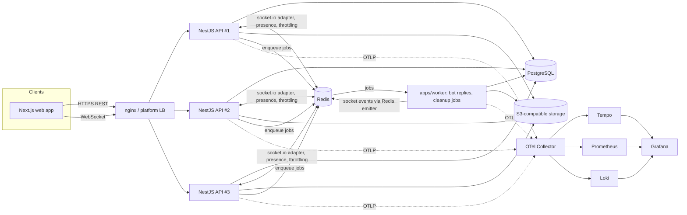
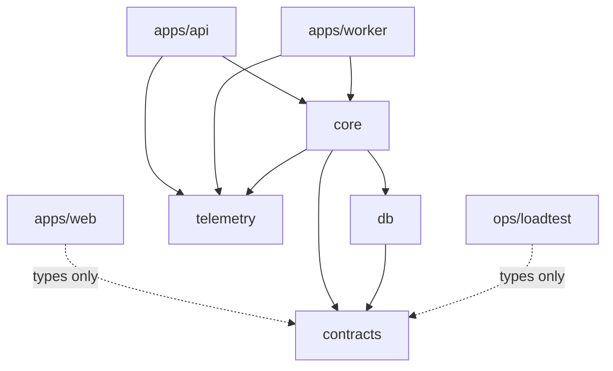
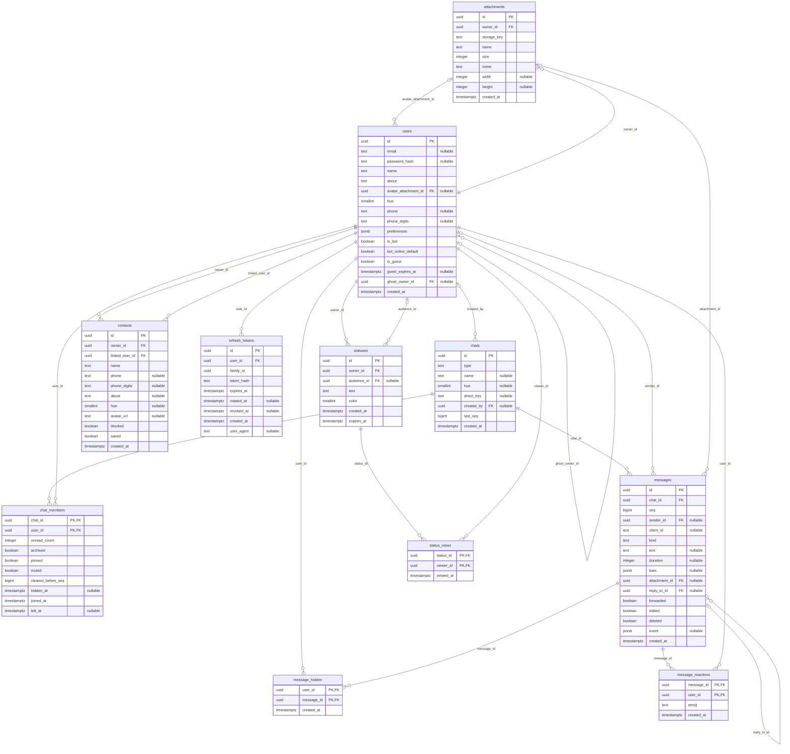
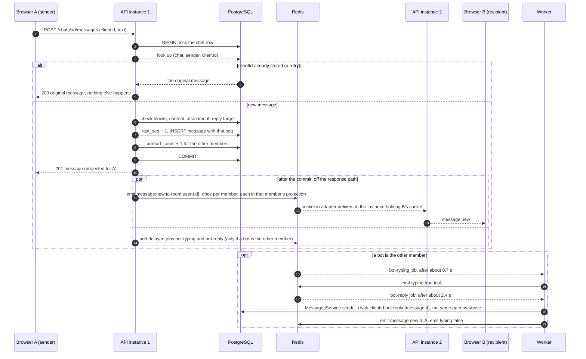
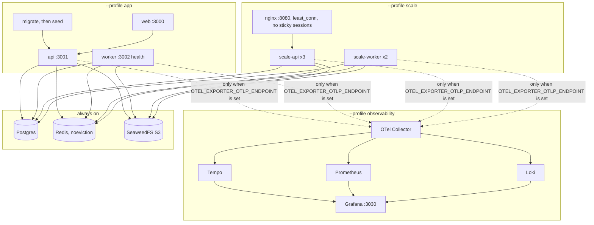
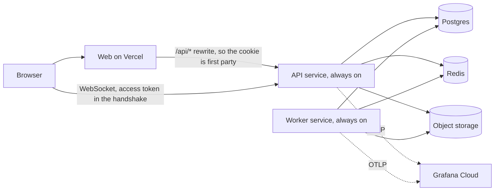

# Architecture

Four diagrams, each answering one question: what are the parts, what is stored, what happens when one
message is sent, and where does it all run. They are Mermaid, which GitHub renders in the page. The
decisions behind them are in the [ADRs](adr/README.md).

## 1. The parts

Two deployables, `apps/api` and `apps/worker`, share domain code through `packages/`. Every business rule
has one implementation in `packages/core`, and both apps call it. The API and the worker never import each
other (`pnpm lint:boundaries` fails the build if they do). See
[ADR 0001](adr/0001-two-deployables-shared-libraries.md).

What holds state: PostgreSQL (everything durable), Redis (socket.io rooms, presence, throttling counters,
job queues) and the S3-compatible store (file bytes). The API and worker processes hold none that matters,
which is why any number of them can run. [docs/scaling.md](scaling.md) has the measurements.

Package dependencies point one way:

## 2. What is stored

Generated from the newest Drizzle snapshot (`packages/db/drizzle/meta`) by
`node ops/scripts/gen-er-diagram.mjs`, and checked in CI (`--check`), so it cannot drift from the schema.
Ids are UUIDv7, so they sort by creation time. `messages.seq` is the message's place in its chat and is
what history paging is built on ([ADR 0015](adr/0015-cursor-paging-over-offset.md)).

<!-- er-diagram:start -->

<!-- er-diagram:end -->

Three things the diagram does not say:

- `contacts` is each person's own address book. The same person has a different contact id for every viewer,
  which is why one `Projector` turns user ids into the viewer's ids on the way out
  ([ADR 0003](adr/0003-per-viewer-projection.md)).
- `chat_members` holds per-person chat state (unread count, pinned, archived, muted, what was cleared). The
  unread count is a counter written in the send transaction, never a `COUNT(*)`.
- `message_hidden` is both "delete for me" and how a message to someone who blocked you is kept from them
  for good ([ADR 0017](adr/0017-blocking-semantics.md)).

## 3. One message, from the browser to the other browser

`POST /chats/:id/messages` with a client-made `clientId`. The sender's response does not wait for the
fan-out: after the commit the API instance queues the announcement to the chat's members (each instance keeps a
chat's announcements in order, and there is no ordering lock across instances,
[ADR 0009](adr/0009-realtime-delivery-and-presence.md)), and, if the other person is a bot, schedules the bot's
reply as delayed jobs.

A replay (step 4, the `alt` branch) adds no message, no unread count and no event. Five concurrent sends of the
same `clientId` produce one message, because the chat row lock orders them and the unique index on
`(chat_id, sender_id, client_id)` backs that up ([ADR 0014](adr/0014-idempotency-keys-for-sends.md)).
The worker sends the bot's reply through the same `MessagesService.send`, so a retried job is also a replay.

## 4. Where it runs

### Docker Compose (what the repository runs today)

One Compose file, three modes. The default profile-less `docker compose up -d` starts only the services
(Postgres, Redis, S3-compatible storage) for development on your machine.

### Hosted demo (planned, not provisioned)

This is the planned shape. Nothing here exists yet, and hosts, plans and prices have to be checked
when the demo is deployed. It is drawn so the production configuration (cookies, `TRUST_PROXY`, CORS, rewrites) has
one picture to refer to.

