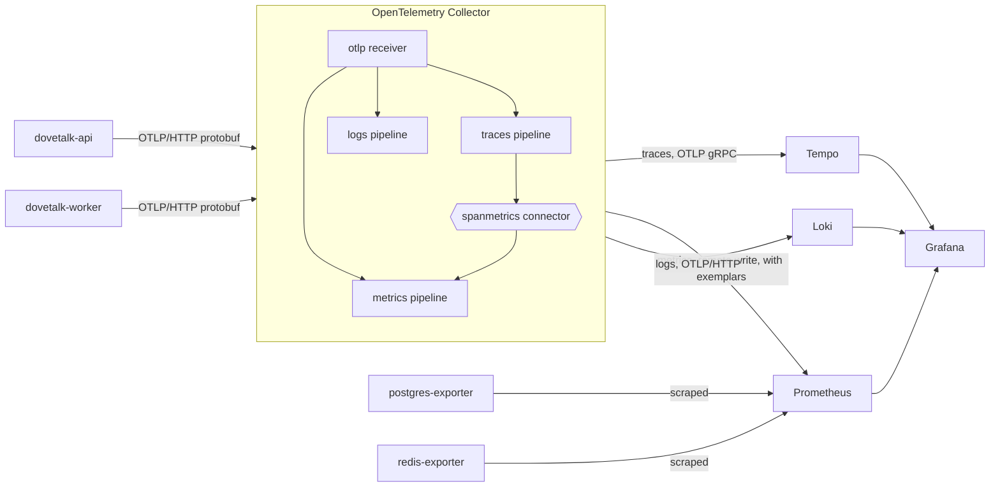

# Observability

Dovetalk's API and worker send traces, metrics and logs with OpenTelemetry (OTel). A Collector sits in
front, and Grafana shows all three: dashboards for the numbers, and a trace you can follow from a request
through Redis and the worker's job to the database, with the log lines of each step one click away.

Everything is code: the instrumentation in `packages/telemetry`, the pipeline and dashboards in
`ops/docker/`. The decisions are in [ADR 0012](adr/0012-opentelemetry-stack.md).

> **What was and was not exercised.** The numbers, traces, logs and alerts in this page were produced by
> running the real apps against native builds of the Collector, Tempo, Loki, Prometheus and the two
> exporters (sections "How it was checked" and "Overhead"). The **Grafana UI was never opened**: there is no
> Grafana binary reachable from the build environment and no Docker daemon. What was checked there is the
> provisioning files (they parse, and every datasource reference points at a uid that exists) and the
> dashboards (the committed JSON is what the generator writes, and every one of the 28 queries returns data
> from a running Prometheus). There are **no screenshots** yet, see the shot list at the end.

## Start it

```bash
cp .env.example .env
OTEL_EXPORTER_OTLP_ENDPOINT=http://otel-collector:4318 \
  docker compose --profile app --profile observability up -d --build
```

Open Grafana at http://localhost:3030 (no login) and the dashboards in the "Dovetalk" folder. To make it
permanent, put the `OTEL_EXPORTER_OTLP_ENDPOINT` line in `.env` (it is there, commented out).

The apps send nothing unless that variable is set, which is why the one-liner needs it. The reason is in
"Overhead": telemetry is not free, and most runs of the stack do not want it. `TELEMETRY_ENABLED=false`
switches it off even when an endpoint is set.

## The pipeline



- **In the apps** (`packages/telemetry/src/start.ts`): the Node SDK with OTLP exporters, loaded before the
  app by `node --import ./dist/instrumentation.js`. Automatic instrumentation for HTTP, Express, Nest, pg,
  ioredis, socket.io and pino. Our own spans and metrics are made with `withSpan` and `dovetalkMetrics`.
  Resource attributes: `service.name` (`dovetalk-api`, `dovetalk-worker`), `service.version`,
  `service.instance.id` (the container's `HOSTNAME`), `deployment.environment`.
- **Collector** (`ops/docker/otel-collector.yaml`): one receiver, three pipelines. It also runs the
  `spanmetrics` connector, which turns spans into the RED metrics (below).
- **Tempo** stores traces, **Prometheus** takes metrics by remote write (the apps are not scraped), **Loki**
  takes logs over OTLP. Retention is 24 hours in all three. Grafana has the three as datasources, linked to
  each other (`ops/docker/grafana/provisioning/datasources/datasources.yaml`).
- Logs are the apps' pino lines. `PinoInstrumentation` adds `trace_id`, `span_id` and `trace_flags` to each
  line and also sends it over OTLP, so the same line goes to stdout and to Loki.

## What the apps measure

Every name below is what Prometheus shows. "OTel type" is how it is recorded in the app. Resource attributes
become labels on every series, so each has `service_name`, `service_instance_id`, `deployment_environment`
and a few host labels as well as the ones listed; Prometheus adds `job` (= the service name) and
`instance` (= the instance id).

### Ours

| Prometheus name | OTel type, Prometheus type | Labels | What it says |
| --- | --- | --- | --- |
| `ws_connections` | UpDownCounter, gauge | none | Open WebSocket connections on one API instance. Sum over instances. |
| `messages_sent_total` | Counter, counter | `kind` | Messages stored. A replayed (idempotent) send is not counted. People and bots both. |
| `message_fanout_duration_ms` (`_bucket`, `_sum`, `_count`) | Histogram, histogram | `event` | Milliseconds from the send committing to its events being published to Redis. |
| `socket_events_total` | Counter, counter | `event`, `direction` | Socket events that left (`out`, counted at publish, per recipient) or arrived (`in`, only `typing`). |
| `bot_reply_duration_ms` | Histogram, histogram | `outcome` | Time a bot-reply job spends choosing and sending the reply. |
| `job_duration_ms` | Histogram, histogram | `queue`, `job_name`, `outcome` | One run of one job. |
| `jobs_total` | Counter, counter | `queue`, `job_name`, `outcome` | Job runs finished, `outcome` is `ok` or `error`. |
| `queue_jobs` | Observable gauge, gauge | `queue`, `state` | Jobs per queue and state (`active`, `delayed`, `failed`, `waiting`). Every replica reports the same number, so use `max`, not `sum`. |
| `db_pool_connections` | Observable gauge, gauge | `state` (`total`, `idle`, `waiting`) | The process's own `pg` pool. |
| `db_pool_max` | Observable gauge, gauge | none | The pool's size limit. |

### Added by the automatic instrumentation

| Prometheus name | What it says |
| --- | --- |
| `http_server_request_duration_seconds` (histogram) | Every request the API served, **unsampled**. Labels `http_request_method`, `http_route`, `http_response_status_code`, `url_scheme`. |
| `http_client_request_duration_seconds` (histogram) | Outgoing HTTP calls (the S3 client). |
| `db_client_operation_duration_seconds` (histogram) | Every pg query, by `db_operation_name`. |
| `db_client_connection_count`, `_max`, `_pending_requests` | The same pool as `db_pool_*`, as the `pg` instrumentation reports it. |

### Made by the Collector from spans

| Prometheus name | What it says |
| --- | --- |
| `traces_span_metrics_calls_total` | Spans finished, by `service_name`, `span_name`, `span_kind`, `status_code`, `http_route`, `http_request_method`, `http_response_status_code`. |
| `traces_span_metrics_duration_milliseconds` (histogram) | Their durations, buckets 2 ms to 10 s, **with exemplars**. |

These are what the RED dashboard and both alerts read. They count **sampled** spans only, see "Sampling".

### Scraped from the exporters

`pg_*` (339 metric names, from `postgres_exporter`) and `redis_*` (162, from `redis_exporter`). The data
dashboard uses `pg_stat_activity_count`, `pg_stat_database_*`, `redis_connected_clients`,
`redis_memory_used_bytes`, `redis_commands_processed_total` and a few more.

### Why durations end in `_ms` and have no unit

The Collector's Prometheus remote write adds a unit suffix when an instrument has a unit: a histogram in
`ms` becomes `..._milliseconds`, and one in `s` becomes `..._seconds`. Our histograms are recorded in
milliseconds because that is how the code measures time, and the histogram buckets are in milliseconds.
They are declared **without** a unit and with `_ms` in the name, so the name is the same in the code, in
Prometheus and on the dashboards. (The span metrics are the exception: the connector names them
`..._duration_milliseconds` itself, and the instrumentation's own histograms use seconds.)

### Why the job label is `job_name`

Prometheus gives every series a `job` label. The Collector's remote write maps `service.name` to it, and
when a metric attribute is also called `job` the resource wins. The first version recorded the BullMQ job's
name as `job`, so every job read `job="dovetalk-worker"` and the "jobs by name" panels showed one line. The
label is `job_name`. A test asserts it (`apps/worker/test/telemetry.test.ts`), and so did the dashboard check, which is how the wrong value was found.

## RED and exemplars

Rate, errors and duration of the API come from the Collector's `spanmetrics` connector, not from the apps:
the JavaScript metrics SDK cannot attach exemplars to a histogram, and the connector can. Each latency
bucket carries the trace id of one request that fell in it. Grafana shows exemplars as dots on the
histogram panel, and the Prometheus datasource is set (`exemplarTraceIdDestinations`) to open the trace in
Tempo when you click one.

Prometheus needs `--enable-feature=exemplar-storage` to keep them (the Compose file sets it). It was checked
by running: `/api/v1/query_exemplars` on `traces_span_metrics_duration_milliseconds_bucket` returns
exemplars with a `trace_id`, and each of those ids was found in Tempo.

## Follow one message from the browser to the database

Browser tracing is not built (see "Not done"), so the trace starts at the API.

**In Grafana** (not exercised, see the note at the top):

1. Send a message in the app. Open the dashboard **API: rate, errors, duration**. In "Latency (p95)" the
   exemplar dots are single requests. Click one near the time you sent, then **Query with Tempo**. (Or open
   Explore, choose Tempo, search `{ resource.service.name = "dovetalk-api" && name = "POST /chats/:chatId/messages" }`.)
2. The trace has one tree across two services: `POST /chats/:chatId/messages` (API), then `message.send`
   with its `pg.query` spans (`BEGIN`, the inserts, `COMMIT`), `realtime.fanout message:new` with one
   `publish` per recipient, then `bot-replies publish` (the jobs are queued), and under it the worker's
   `bot-replies process` spans, which end in a second `message.send` and its own fan-out.
3. Click a span, then **Logs for this span** (or the Logs button on the trace). It opens Loki with
   `{service_name=~".+"} | trace_id="<the id>"`, which finds the API's `request completed` line and the
   worker's `Job typing done` and `Job reply done` lines.
4. From a log line in Loki, the **Open trace** link next to `trace_id` goes the other way.

**With the HTTP APIs** (this is how it was checked, with native binaries):

```bash
# 1. Send a message under a trace id you choose. The API continues the trace you give it.
TRACE=$(openssl rand -hex 16)
curl -X POST http://localhost:3001/chats/$CHAT_ID/messages \
  -H "authorization: Bearer $TOKEN" -H 'content-type: application/json' \
  -H "traceparent: 00-$TRACE-$(openssl rand -hex 8)-01" \
  -d '{"clientId":"'$(uuidgen)'","kind":"text","text":"hello"}'

# 2. The trace, from Tempo (give it a few seconds to arrive).
curl -H 'Accept: application/json' http://localhost:3200/api/v2/traces/$TRACE

# 3. Its log lines, from Loki. trace_id and span_id are structured metadata.
curl -G http://localhost:3100/loki/api/v1/query_range \
  -H 'X-Loki-Response-Encoding-Flags: categorize-labels' \
  --data-urlencode "query={service_name=~\".+\"} | trace_id=\"$TRACE\"" \
  --data-urlencode "start=$(( $(date +%s) - 600 ))000000000" --data-urlencode "end=$(( $(date +%s) + 60 ))000000000"
```

(Tempo and Loki are not published on a host port in Compose; the `localhost:3200` and `localhost:3100` above
assume you added a `ports:` entry, or run the `curl` inside the network with `docker compose exec`.) Tempo's v2 JSON gives span ids as base64: decode them to hex before comparing
them with the `span_id` of a log line. They do match: the worker's lines carry the id of their own
`bot-replies process` span.

On a real run one message gave **one trace of 98 spans** across `dovetalk-api` and `dovetalk-worker`.

## How logs find their trace

- The apps write JSON with pino. `PinoInstrumentation` adds `trace_id`, `span_id` and `trace_flags` to each
  line while a span is active.
- The same line is sent to the Collector as an OTLP log record and on to Loki's `/otlp` endpoint. Loki keeps
  the three fields as **structured metadata**, not as index labels. The only index labels are
  `service_name`, `service_instance_id` and `deployment_environment`, so cardinality stays low and a trace id
  is still searchable: `| trace_id="..."`. Loki needs `allow_structured_metadata: true` for this
  (`ops/docker/loki.yaml`).
- **Trace to logs**: the Tempo datasource's `tracesToLogsV2` has a custom query,
  `{service_name=~".+"} | trace_id="${__trace.traceId}"`, with a minute of slack on each side.
- **Log to trace**: the Loki datasource has a derived field `trace_id` (matched as a field, since it is
  metadata and not part of the line) that links to Tempo.
- **A worker detail that matters.** BullMQ reports `completed` and `failed` after the processor returned,
  when the job's span has already ended and nothing is active, so the "done" and "failed" lines used to be
  written with no trace id and trace-to-logs found nothing. `runWorker` keeps each job's span context and
  writes those two lines inside it (`captureContext` / `runInContext`). A test fails without it.

## Sampling

One message send makes about 98 spans. In the trace that was checked: 59 from `pg` (38 queries, 20
`pg-pool.connect` and one `pg.connect`, in the API and the worker together), 23 from Redis (10 fan-out
`publish`es, the rest the queue's and other commands), 8 Express middleware spans, and 8 of our own (the
request, `message.send` and `realtime.fanout` in both services, `bot-replies publish`, and the two
`bot-replies process` jobs). At about 135 sends a second, which is what the 2 CPU machine in "Overhead"
managed, that is on the order of 10,000 spans a second, against an exporter queue of 2048 spans.

**Are spans dropped?** Only partly known. A short run with a working Collector, at about 41 sends a second
(about 4,000 spans a second, on a smaller 1 CPU machine) and the SDK logging at `warn`
(`OTEL_LOG_LEVEL=warn`), produced no "Dropped ... spans" line in either service. The SDK does report a drop
at that level: with `OTEL_BSP_MAX_QUEUE_SIZE=64` the same run printed `Dropped 10 spans because
maxQueueSize reached`, so the silence at the default size means none were dropped *at that rate*. The
10,000-spans-a-second rate was **not tested**, so whether a Collector that is keeping up still loses spans
there is unknown. If you see that line, raise `OTEL_BSP_MAX_QUEUE_SIZE` or sample.

- `OTEL_TRACES_SAMPLER=parentbased_traceidratio` with `OTEL_TRACES_SAMPLER_ARG=0.1` keeps 10% of traces
  (checked: over a 40 s load run, the sampled span metric counted 182.9 requests to
  `POST /chats/:chatId/messages` against 1,791.5 for the same route in the unsampled
  `http_server_request_duration_seconds_count`, a ratio of 0.102, and the load driver had sent 1,945, a ratio
  of 0.094). It is *parent based*: a request that arrives with a `traceparent` the caller sampled stays sampled, and the
  worker keeps whatever the request decided, so a trace is never cut in half.
- Metrics and logs are not sampled. Every log line still carries its `trace_id`, but only a sampled trace
  can be opened from it.
- **The RED dashboard and the alerts read span metrics, which count sampled spans.** Requests per second
  there is the true rate times the ratio. Error *ratio* and latency percentiles stay right (they are
  ratios and distributions), but the `> 0.2 requests/s` guard on `ApiErrorRateHigh` and the absolute rate
  panels do not. If you sample, either scale the rate by the ratio or read the unsampled
  `http_server_request_duration_seconds` from the SDK instead.
- What sampling does to the cost is in "Overhead".

## Overhead

Telemetry is not free, so this measures it. These are API CPU seconds per message sent, which
isolates the cost better than throughput does on a machine that is shared with the load driver.

**How it was measured.** One machine: 2 CPUs, 8 GB, Node 26.13.1, native binaries and no Docker, with the apps,
Postgres, Redis, the Collector, Tempo, Loki and Prometheus all on it. The load driver (16 clients, 8 users, one
socket per user, closed-loop sends to bot chats) also uses CPU, so throughput is noisy and the figures are
indicative, **not a capacity**. Each condition: restart the API and the worker, 10 s warm-up, 40 s measured,
three repetitions interleaved with the other conditions, median and range reported. The CPU per message of the
same condition grows as the database grows over a session (telemetry off read 3.69 ms early, 3.90 ms later and
4.58 ms in the fifth round in a row), so **only compare rows of the same set**.

**What "off" means.** `TELEMETRY_ENABLED=false`. `instrumentation.js` still imports the telemetry package, so
the SDK's modules are loaded, but `startTelemetry` returns without starting anything: no patches, no
processors, no exporters. "Off" is not "the package is absent".

Set 1 (before the export guard existed):

| Condition | Sends/s (range) | p50 / p95 / p99 ms | API CPU per send, ms (range) | vs off | API RSS MB |
| --- | --- | --- | --- | --- | --- |
| a. off | 209 (198-210) | 74 / 115 / 153 | 3.69 (3.57-3.70) | - | 320 |
| b. endpoint, full stack | 145 (138-153) | 103 / 173 / 235 | 5.37 (5.12-5.55) | +46% | 447 |
| c. endpoint, Collector whose exporters are all `nop` | 165 (157-167) | 94 / 132 / 178 | 5.15 (5.01-5.37) | +40% | 418 |
| d. endpoint, connection refused (127.0.0.1:4399) | 184 (175-185) | 83 / 126 / 162 | 4.66 (4.55-4.83) | +26% | 450 |
| e. endpoint `http://otel-collector:4318`, name not resolving | 171 (169-178) | 89 / 130 / 164 | 4.74 (4.73-4.93) | +28% | 465 |

Set 2 (the final build, guard on; d0 and e0 are the same build with `TELEMETRY_EXPORT_COOLDOWN_MS=0`):

| Condition | Sends/s (range) | p50 / p95 / p99 ms | API CPU per send, ms (range) | vs off | API RSS MB |
| --- | --- | --- | --- | --- | --- |
| a. off | 196 (184-205) | 77 / 122 / 156 | 3.90 (3.79-3.91) | - | 317 |
| b. full stack | 136 (133-136) | 112 / 180 / 224 | 5.76 (5.74-5.84) | +48% | 421 |
| d. refused | 162 (161-166) | 94 / 144 / 186 | 5.05 (4.99-5.14) | +29% | 406 |
| d0. refused, guard off | 159 (145-169) | 96 / 142 / 178 | 5.28 (4.96-5.53) | +35% | 469 |
| e. unresolvable | 169 (147-180) | 91 / 130 / 167 | 4.90 (4.75-5.53) | +26% | 419 |
| e0. unresolvable, guard off | 158 (152-166) | 96 / 149 / 200 | 5.24 (5.15-5.53) | +34% | 424 |

The guard's effect on CPU is within the noise: the ranges overlap.

Set 3 (sampling, same build as set 2; f keeps 10% of traces, h is `OTEL_TRACES_SAMPLER=always_off`):

| Condition | Sends/s (range) | p50 / p95 / p99 ms | API CPU per send, ms (range) | vs off | API RSS MB |
| --- | --- | --- | --- | --- | --- |
| a. off | 210 (195-215) | 72 / 110 / 148 | 3.62 (3.60-3.72) | - | 315 |
| b. all traces | 133 (126-150) | 109 / 196 / 252 | 5.75 (5.24-5.96) | +59% | 454 |
| f. 10% of traces | 162 (158-185) | 93 / 146 / 194 | 5.05 (4.48-5.10) | +40% | 395 |
| h. no trace kept | 170 (167-178) | 90 / 133 / 174 | 4.79 (4.51-4.80) | +33% | 390 |

**Reading it.** With a Collector, telemetry costs about **1.5x** the API's CPU per message (+46% to +59%).
With nothing listening it costs about **1.3x** (+26% to +35%). An absent Collector costs no more than a
present one. Sampling recovers about a third of the cost, and even when no trace is kept telemetry still costs
+33%, so most of what is left is the instrumentation patches, the log records and the metrics, not the spans.
Throughput and latency follow the CPU: about 135 sends a second against about 200, and a p95 of about 180 ms
against about 120 ms. This is why Compose leaves the endpoint empty (ADR 0012).

**Memory.** API RSS in MB after each of five consecutive 40 s rounds, **without** a restart between them:

| Condition | Rounds 1 to 5 | Peak |
| --- | --- | --- |
| off | 378, 338, 336, 336, 339 | 378 |
| working Collector | 446, 379, 386, 388, 399 | 446 |
| refused, guard on | 452, 473, 437, 490, 421 | 490 |
| refused, guard off | 475, 509, 512, 667, 484 | 668 |
| unresolvable, guard on | 465, 571, 450, 406, 428 | 571 |

(Before the guard existed: off 333 to 387, flat; working Collector 398, 419, 470, 433, 439; refused 557, 567,
672, 567, 719; unresolvable 481 rising to 720.) The working-Collector rounds of this set ran at only about 100
sends a second because the machine was slow after the stack restarted, so use this set for RSS and not for
throughput.

Node's diagnostic reports of the API (`javascriptHeap`) after five rounds: with telemetry off the heap in use
was about 110 MB and flat; with a working Collector about 200 MB and flat; with no Collector and no guard the
old space grew from 176 to 402 MB (heap in use 210 to 432 MB, 504 MB committed); with the guard the heap in use
was 177 MB and 306 MB committed.

**Caveats.** One small machine that is shared with the load driver. Three repetitions per condition, and the
ranges overlap in places. Indicative, not a capacity: it should be repeated on separate machines. The
tables are from experiments whose scripts are not in the repo and were not re-run for this page.

## When the Collector is unreachable

Nothing breaks and nothing is printed, but it is not free. With an endpoint set and nothing answering
(connection refused, or a name that does not resolve) the apps keep serving, log no export error (checked
under load on the final build: no warn or error line in either service at the default log level) and cost about
1.3x CPU per message (above).

Memory was the problem. The span and log processors are bounded (a queue of 2048, one export in flight at a
time), but the OTLP exporter retries five times with backoff, about 13 seconds, before it reports a failure.
Each batch therefore lives through that whole cycle, gets promoted to the old generation of the JS heap and the
heap stretches. Without the fix, API RSS reached 557 to 719 MB over five rounds under load.

- **The export guard** (`guardExporter`). After an export fails, the next exports for
  `TELEMETRY_EXPORT_COOLDOWN_MS` (default 30000, `0` turns it off) fail at once, so a batch is dropped early
  rather than late. When the cooldown is over the next batch is tried, and one that gets through ends it.
- **`OTEL_BSP_*` and `OTEL_BLRP_*` now work.** They are the standard settings for the span and log processors
  (queue size, batch size, delay, timeout). The SDK reads them only when it builds the processors itself, and
  `startTelemetry` builds them, so they were silently ignored until commit aa80efc.

The guard **reduces** the peaks (490 MB against 668 without it, refused; 446 MB was the peak with a working
Collector). It does **not** eliminate the variance: one run with an unresolvable name still spiked to 571 MB.
If the Collector is down on purpose, turn telemetry off
(`TELEMETRY_ENABLED=false`) rather than rely on the guard.

## Alerts

`ops/docker/alerts.yml`, loaded by Prometheus (http://localhost:9090/alerts). Alertmanager is not wired up,
on purpose: the rules show in Prometheus and that is enough for a demo.

| Alert | Fires when | Tested |
| --- | --- | --- |
| `ApiErrorRateHigh` | More than 5% of the API's server spans failed (5xx) over 5 minutes, with more than 0.2 requests/s, for 5 minutes | Went pending, then **firing** at a real value of 0.33. The load was 40 successful sends/s plus 20 uploads/s that failed with 500 because the S3 store was stopped. |
| `ApiLatencyP95High` | p95 of server spans above 500 ms for 10 minutes | Evaluated to 212 ms at normal load (inactive). Under saturation it went pending and then **firing**: a 690 s run with 96 clients and 8 users (see below) went pending at 03:49:15, and the first poll after the ten minutes (03:59:29) read **firing** at a real value of 4,128 ms (4,262 ms at the end). |
| (rule syntax) | | `promtool check rules` passes. |

**The latency run.** `load 690 96 8`: a throwaway driver (not in the repo) that registers 8 users, opens one socket.io
websocket per user and sends to their bot chats from 96 closed-loop clients for 690 s, against the real apps with
telemetry on and native builds of the Collector, Tempo, Loki and Prometheus, on one machine with 1 CPU and 4 GB, Node 26.13.1,
where the stack and the driver shared the CPU. 32,745 sends, none failed, 47.5 a second, driver-side p50 1,957 ms, p95 2,902 ms,
p99 3,643 ms. Neither app logged a warn or error line, and `ApiErrorRateHigh` stayed inactive. The span-metric p95 read
3,971 ms just before it fired and 4,073 to 4,206 ms in the polls after. That is this box saturated, not a capacity figure.
An earlier, shorter run (993 ms under 96 clients) only got as far as pending.

The error-rate panel's numerator ends in `or vector(0)`, so it reads 0 when nothing failed instead of "No data".

## Grafana Cloud

The same code exports to Grafana Cloud with standard OTLP settings, in `.env`:

```bash
OTEL_EXPORTER_OTLP_ENDPOINT=https://otlp-gateway-<region>.grafana.net/otlp
OTEL_EXPORTER_OTLP_HEADERS=Authorization=Basic <base64 of instanceId:token>
OTEL_EXPORTER_OTLP_PROTOCOL=http/protobuf
```

Caveat: Grafana Cloud generates its own span metrics, under different names (`traces_spanmetrics_*`) and
without our exemplars. The dashboards here read the Collector's `traces_span_metrics_*`, so for the RED
dashboard keep the Collector in front and point *it* at Cloud (add Cloud's OTLP exporter to the Collector's
pipelines), rather than pointing the apps at Cloud directly. Direct export is fine when you only want traces
and logs. This was **not tried** against a real Cloud stack.

## How it was checked

Not with Docker (there is no daemon in the build environment) and not in Grafana, but with the real binaries
of the same versions as the Compose images, and the real apps, running natively. The overhead numbers come from a 2 CPU,
8 GB machine; the final-build smoke checks below were repeated on a smaller 1 CPU, 4 GB machine (Node 26.13.1),
so their throughput is not comparable and none of it is quoted here.

- **Trace**: one `POST /chats/:id/messages` sent under a trace id I chose gave one trace, 98 spans, one root,
  across both services, with the parent links intact (API request, `message.send`, `bot-replies publish`, the
  worker's `bot-replies process`, the worker's `message.send`, its fan-out). The bot's reply arrived after
  2.7 s.
- **Logs**: `{service_name=~".+"} | trace_id="<id>"` returned the API's `request completed` line and the
  worker's `Job typing done` and `Job reply done`, each carrying exactly the id that was sent. The `span_id`s
  on them are real spans in Tempo: the request span and the two `bot-replies process` spans.
- **A failing job**: a bot-reply job with a malformed chat id failed both attempts. The worker logged them,
  the final `failed` line carries the trace id and span id of the failing `bot-replies process` span (which has
  `STATUS_CODE_ERROR`), and `jobs_total{job_name="reply",outcome="error"}` counted 2. A job for a chat that does
  not exist is not a failure, it finishes with the result `nobody`.
- **Metrics**: all 28 dashboard queries were run against Prometheus after a load run, real errors (200 uploads
  that failed with 500 because the S3 store was stopped, 100 404s and 100 422s) and the failing job. Every one
  returns series, and every `{{label}}` in a legend exists on the series, including `job_name`. The values were
  looked at too: `job_name` holds `reply`, `typing` and the four maintenance tasks, not the service name. The
  script is a throwaway and is not in the repo.
- **Sampling**: 10% keeps about 10% (see "Sampling").
- **Silence with no Collector**: see "When the Collector is unreachable".
- **Exemplars**: present on the server-span latency histogram, with trace ids that exist in Tempo (checked in
  an earlier session).
- **Alerts**: see the table above.
- **Config**: `docker compose config -q` passes for the default, `app`, `observability` and both profiles
  (Compose v2.40.3, no daemon), the resolved config has the endpoint empty by default and set by the one-liner,
  the Collector's `validate` and `promtool check config` pass, and the committed dashboards are byte-identical
  to what the generator writes. The CI job `compose-config` runs the same.
- **Not checked**: the Grafana UI (provisioning load, dashboards rendering, the three data links), the Docker
  images and their tags (Docker Hub and the other registries were not reachable), Alertmanager, Grafana
  Cloud, spans dropped at 10,000 spans a second. See the ADR for how the versions were confirmed.

## Not done

Listed in the pull request description ([docs/pull-requests/observability.md](pull-requests/observability.md)), repeated here so they are not lost:

- Browser tracing (a stretch goal) is not built, so a trace starts at the API.
- About 8 Express middleware spans per request say nothing (`request handler - {/*splat}` and friends; they
  also show up as an `http_route` of `{/*splat}` in the span metrics), and the `ioredis` connect spans (`hello`,
  `client`, `info`) sit under the first publish. Together with the `pg` spans that is about 98 spans per send.
- Resource attributes such as `process.command_args`, and the response headers pino logs, are kept by Loki as
  structured metadata on every line, which is a lot of volume.
- `bullmq-otel` 2.0.1, the BullMQ authors' package for BullMQ 6, was found late and **not tried**. The manual
  spans stay for now (ADR 0012).
- The Grafana UI was never exercised and there are no screenshots.
- The export guard does not fully flatten memory when there is no Collector (see "When the Collector is
  unreachable").
- Whether spans are dropped at 10,000 spans a second with a working Collector was not measured.
- Alertmanager is not wired.
- With `OTEL_LOG_LEVEL` set the apps print two harmless startup warnings (`Current logger will be
  overwritten`), because our code and `NodeSDK` both register the diagnostic logger.

## Screenshots

No screenshots are committed, because the stack has not been run with traffic and rendered. To add them, put them in
`docs/images/observability/` and link them here: (1) **API: rate, errors, duration** with some load,
exemplar dots visible; (2) a trace of one message send, expanded to show both services; (3) the same trace
with **Logs for this span** open; (4) **Realtime** with a few sockets connected; (5) **Jobs and queues**;
(6) the Prometheus **Alerts** page.
